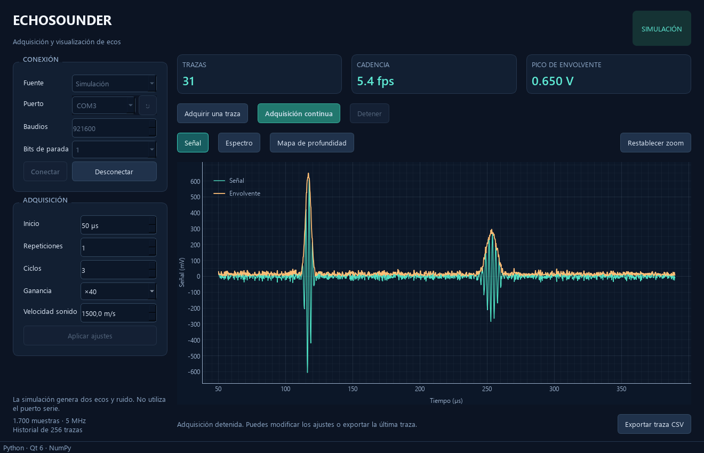

# Echosounder

Aplicación de adquisición y visualización para una ecosonda: señal temporal, espectro y mapa de profundidad.

## Versión Python

Implementación con PySide6, PyQtGraph, NumPy y pySerial. Incluye un modo de simulación para utilizarla sin hardware, adquisición en un hilo independiente y exportación CSV.



Con el entorno local ya instalado, abre **`Echosounder-Python.bat`** o ejecuta:

```powershell
.\.venv\Scripts\python.exe -m echosounder --simulate
```

Para instalar desde cero con Python 3.11 o posterior:

```powershell
python -m venv .venv
.\.venv\Scripts\python.exe -m pip install -e .
.\.venv\Scripts\python.exe -m echosounder
```

Consulta [la guía de Python](docs/PYTHON.md) para conectar el instrumento, ejecutar las pruebas y conocer las diferencias respecto al original. La comunicación física está pendiente de validar con el firmware y el hardware; las pruebas disponibles utilizan simulación.

## Aplicación original de Windows

`SonarFrontEnd.exe` se conserva con las DLL, los plugins de Qt 5 y las traducciones que necesita. Para ejecutarlo, descarga el repositorio completo, extrae el ZIP y conserva las carpetas junto al ejecutable.

No se dispone de sus fuentes originales. El [estudio técnico](analysis/ESTUDIO_ECHOSOUNDER.md), el [inventario de dependencias](analysis/DEPENDENCIAS.md) y la [guía de reconstrucción](analysis/RECOMPILACION.md) documentan el análisis del binario y los archivos objeto conservados localmente.
