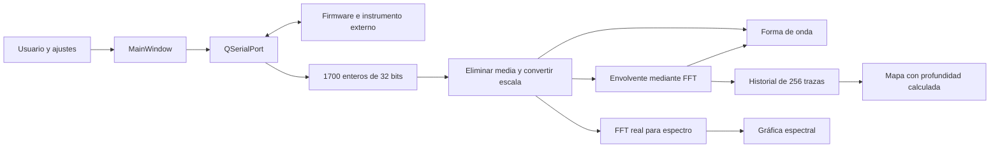

# Estudio técnico de Echosounder / SonarFrontEnd

Fecha del análisis: 6 de noviembre de 2026.

## Resultado y alcance

La aplicación es una interfaz de Windows para controlar un instrumento de ecosonda por puerto serie, recibir sus trazas y representarlas como forma de onda, espectro o mapa de profundidad. Se identifica en pantalla como **Echosounder v0.1**; el ejecutable se llama `SonarFrontEnd.exe`.

El conjunto disponible es una distribución compilada acompañada de nueve archivos objeto y cinco archivos generados durante la construcción. El usuario confirma que no dispone del proyecto original ni del firmware. Por tanto, este estudio combina inspección del ejecutable, desensamblado de los objetos, metadatos de Qt y una ejecución local sin conectar al instrumento. No equivale a una auditoría del fuente original ni a una validación de las medidas físicas.

Los nueve objetos conservados se han correlacionado con la sección de código del ejecutable: **389.544 bytes de código, excluidas las posiciones de reubicación, coinciden sin diferencias**. Esto permite atribuir al ejecutable las funciones analizadas en los `.o`, en lugar de suponer que pertenecen a otra versión. La comprobación está en [recovery.json](evidence/recovery.json).

| Identificación | Evidencia |
| --- | --- |
| Formato | PE32+, arquitectura AMD64, aplicación GUI de Windows |
| Lenguaje | C++11, macro `__cplusplus = 201103L` |
| Compilador | MinGW-w64 GCC 7.3.0, POSIX threads, excepciones SEH |
| Framework | Qt 5.14.2, DLL de ejecución y generadores `moc`/`rcc` coincidentes |
| Gráficas | QCustomPlot enlazado dentro del ejecutable; versión exacta no confirmada |
| Optimización | `__OPTIMIZE__ = 1`; sin secciones de depuración en el ejecutable |
| Marca temporal PE | 26-11-2020, 10:35:24 UTC; es un campo del binario, no una prueba de procedencia |
| SHA-256 del EXE | `70d8440558fd2bf5920ddc03cb6c5b58215e43267fa42cb78b6ff0085a08e026` |

## Qué hace el usuario

La ventana tiene los menús Connection, Control y Display y una barra de herramientas. La forma de onda es la vista inicial. Al arrancar, Connect y Settings están disponibles; Disconnect y las adquisiciones están deshabilitados. En la máquina analizada mostró `Not connected. Default port COM3.`; COM3 es un resultado de la enumeración local, no un puerto fijo del programa.

| Control | Comportamiento reconstruido |
| --- | --- |
| Connect | Selecciona el puerto configurado, fija la velocidad, abre lectura/escritura y envía la comprobación de respuesta |
| Disconnect | Cierra la comunicación y vuelve al estado desconectado |
| Settings | Enumera de nuevo los puertos y abre ajustes de conexión, adquisición y visualización |
| Acquire Single | Solicita y representa una traza |
| Acquire Continuously | Repite solicitudes en un bucle hasta que se pulsa Stop |
| Stop | Cambia el estado del bucle; no se ha encontrado una orden serie específica para detener el instrumento |
| Waveform | Muestra la señal temporal y su envolvente |
| Spectrum | Muestra el resultado de la FFT |
| Depth map | Muestra el historial de trazas como mapa de color |
| Reset Zoom | Reescala los ejes de las gráficas visibles |

Las tres vistas son excluyentes. La acción correspondiente a la vista activa se deshabilita y las otras dos se habilitan. Cambiar la vista no fuerza una adquisición nueva; las representaciones se actualizan durante las adquisiciones posteriores.

No aparecen acciones de guardar, cargar, grabar datos ni exportar. QCustomPlot contiene funciones de exportación y de impresión, pero su presencia en la biblioteca enlazada no demuestra que la aplicación las exponga. Tampoco se ha encontrado en el código de la aplicación una interfaz de red, una base de datos, audio del PC o almacenamiento de ajustes mediante `QSettings`.

## Arquitectura y flujo



| Objeto | Responsabilidad identificada |
| --- | --- |
| `main.o` | Construye `QApplication`, crea y muestra `MainWindow`, ejecuta el bucle de eventos de Qt mediante `qMain` |
| `mainwindow.o` | Ventana, selección de puertos, ajustes, protocolo, adquisición, escalas y presentación |
| `settings.o` | Diálogo de ajustes, listas de ganancia y copia de los valores aceptados |
| `fft.o` | FFT compleja, FFT real, transformadas seno/coseno, espectro, envolvente y un filtro básico |
| `qcustomplot.o` | Implementación del widget de gráficas y mapas de color |
| `moc_mainwindow.o`, `moc_settings.o`, `moc_qcustomplot.o` | Metainformación Qt, slots y tablas virtuales |
| `qrc_reources.o` | Recursos gráficos incorporados al programa |

El código generado `moc_mainwindow.cpp` identifica once slots, incluidos los diez controles y `readData()`. Este último **no procesa datos: contiene únicamente un retorno**. La adquisición real se realiza en `requestAcquisition()` con esperas explícitas, no en ese slot.

La máquina de estados observable usa los valores 0 = desconectado, 1 = conectado/parado y 2 = adquisición continua. El bucle continuo llama a la adquisición, procesa eventos de Qt, duerme 30 ms y calcula los FPS a partir del tiempo transcurrido. No se ha identificado un hilo de adquisición separado. `QThread::msleep` es una llamada de espera, no una prueba de que exista un hilo trabajador.

## Ajustes

Los valores iniciales siguientes se obtienen del constructor y de las constantes del objeto. Los rangos proceden de la interfaz compilada; no son una validación de los límites admitidos por el firmware.

| Parámetro | Inicial | Rango o selección de la interfaz | Observación |
| --- | --- | --- | --- |
| Puerto | Selección automática | Puertos de `QSerialPortInfo::availablePorts()` | Da preferencia al fabricante que contiene `ST`; si no hay coincidencia, utiliza el primer puerto disponible |
| Velocidad | 921.600 baudios | 0–1.000.000.000 | Se aplica al abrir el puerto; el sistema puede rechazar velocidades no admitidas |
| Bits de parada | 1 | Campo entero con máximo 256 | Se guarda, pero no aparece una llamada a `QSerialPort::setStopBits` |
| Retardo de inicio | 50 | 0–1.000 | La escala temporal usa microsegundos; un tooltip dice milisegundos |
| Repeticiones | 1 | 1–256 | La interfaz describe promediado en el microcontrolador; su implementación exacta no puede verificarse sin firmware |
| Ciclos del pulso | 3 | 1–16 | No hay ajuste visible de frecuencia del pulso |
| Ganancia | Código `0x90`, opción x40 | Diez códigos discretos | La etiqueta dice dB, pero las opciones son factores multiplicativos |
| Velocidad del sonido | 1.500 m/s | 300–5.000 m/s | Solo modifica la conversión temporal a profundidad |

La preferencia por un fabricante que contiene `ST` sugiere un dispositivo de STMicroelectronics. No identifica por sí sola un modelo de STM32, una placa, un transductor o un circuito analógico concreto.

| Opción de ganancia | Código enviado |
| --- | --- |
| x0.2 | `C8` |
| x1 | `80` |
| x10 | `C0` |
| x20 | `A0` |
| x30 | `E0` |
| x40 | `90` |
| x60 | `D0` |
| x80 | `B0` |
| x120 | `F0` |
| x157 | `88` |

No se observa división de la señal por el factor de ganancia antes de representarla. Por ello, los voltios mostrados corresponden a la escala digital reconstruida de la recepción, no a una amplitud acústica calibrada ni necesariamente a la entrada del amplificador.

## Protocolo serie reconstruido

El cliente emplea tramas de petición de cinco bytes y `QDataStream` con orden de bytes **little-endian** para los enteros. La interpretación del orden coincide con el enumerado de [QDataStream](https://doc.qt.io/qt-5/qdatastream.html).

| Orden | Solicitud observada | Respuesta que interpreta el cliente |
| --- | --- | --- |
| `00` | Comprobación de presencia; primer byte cero | Espera cinco bytes y comprueba que el primero sea cero |
| `01` | Solicitud de adquisición | 6.800 bytes: 1.700 enteros con signo de 32 bits, little-endian, sin cabecera procesada por este cliente |
| `02` | Código + repeticiones como entero de 32 bits | Código `02` + entero confirmado; actualiza el ajuste con ese valor |
| `03` | Código + retardo como entero de 32 bits | Código `03` + entero confirmado; actualiza también el eje temporal |
| `04` | Código + ciclos como entero de 32 bits | Código `04` + entero confirmado |
| `05` | Consulta de versión de firmware | Código `05` + cuatro bytes; de esos cuatro usa los índices 1, 2 y 3 para formar `vA.B.C` |
| `06` | Código + un byte de ganancia; longitud total cinco | Código `06` + cuatro bytes; toma el primero de esos cuatro como ganancia confirmada |

Los bytes no descritos de las peticiones `00`, `01`, `05` y `06` no se inicializan explícitamente en el código observado después de `QByteArray::resize(5)`. No se puede presuponer que sean cero. En una reconstrucción habría que fijar un relleno definido y comprobar que el firmware lo acepta.

Secuencia de conexión: abrir puerto → comprobar presencia → habilitar estado conectado → consultar versión → enviar retardo → ciclos → repeticiones → ganancia. No hay negociación visible del número de muestras ni de la frecuencia de muestreo.

`waitForBytes(n)` consulta `bytesAvailable()` y un temporizador, procesando eventos de Qt mientras espera. Su umbral es aproximadamente un segundo. La adquisición comprueba el resultado de la espera; varias funciones de configuración no lo comprueban antes de intentar leer la respuesta. No se identifican CRC, número de secuencia ni un parser de resincronización en estas funciones. Esto describe lo que valida el cliente; no permite concluir cómo protege internamente sus datos el firmware.

Si el puerto se abre pero la comprobación de presencia falla, el código muestra un mensaje y no ejecuta claramente la transición de desconexión en esa rama. Conviene revisar este caso al reconstruirlo. Otro mensaje de error dice literalmente `Could connect to`, aunque corresponde a un fallo de apertura.

## Tratamiento de la señal

### Tamaño, tiempo y profundidad

Las constantes del cliente son:

- 1.700 muestras por traza.
- Intervalo temporal supuesto de 0,2 µs: frecuencia equivalente de 5 MHz.
- 256 trazas de historial para el mapa.
- 512 valores de espectro calculados a partir de una FFT real de 1.024 muestras.

Para una muestra de índice `i` y retardo `D`, el eje temporal se construye como:

```text
t_us[i] = D + 0,2 * i        i = 0 ... 1699
z_cm[i] = t_us[i] * c / 20000
```

El factor dos corresponde al trayecto de ida y vuelta. Con los valores iniciales, el tiempo va de 50 a 389,8 µs y la profundidad calculada de 3,75 a 29,235 cm. La separación de muestras es 0,15 mm para `c = 1500 m/s`; esto es el paso del eje, **no la resolución acústica real**, que depende también del transductor, del pulso y del ancho de banda.

El programa presupone esos 5 MHz; no los mide ni los solicita al instrumento. Sin firmware no se ha podido verificar que la frecuencia física coincida.

### Conversión de las muestras

El cliente lee los 1.700 enteros, calcula su media y la resta. La conversión reconstruida es:

```text
B = 12 + ceil(log2(repeticiones))
V[i] = (raw[i] - media(raw)) * 3,3 / (2^B - 1)
```

Para una repetición el divisor es 4095. La fórmula es compatible con datos procedentes de un ADC de 12 bits y acumulación de trazas, pero solo confirma cómo interpreta los datos el cliente. No prueba el modelo de ADC ni si el firmware suma, promedia o desplaza los resultados de otra forma. Para repeticiones que no sean potencias de dos, la escala usa el siguiente exponente entero; es una dependencia del formato que exige comprobar el firmware o medir con una señal conocida.

La resta de la media se realiza sobre la traza completa. El programa no conserva en la representación temporal la componente continua de la señal original.

### Envolvente y mapa

`hilbert_transform()` rellena la señal con ceros hasta 2.048 muestras complejas, hace FFT, anula parte del espectro y hace la transformada inversa. Devuelve para las 1.700 muestras originales `2 * abs(resultado_complejo) / 2048`. Por tanto, su salida es una envolvente no negativa; no es simplemente la componente imaginaria de la transformada de Hilbert.

El intervalo de anulación observado empieza en `N/2 - 1`, no en el límite habitual `N/2`. Ese detalle debe conservarse para reproducir exactamente el binario o revisarse con señales de prueba para una versión corregida.

La forma de onda muestra dos curvas: señal convertida y envolvente. Ajusta el eje vertical de manera simétrica usando el máximo de la envolvente.

El mapa desplaza el historial e inserta la traza nueva al principio. Cada celda recibe la **raíz cuadrada de la envolvente**, una compresión de amplitud adicional. El mapa tiene 256 × 1.700 celdas; el eje horizontal representa scanlines, sin posición geográfica ni distancia recorrida. La velocidad del sonido escala el eje vertical.

Los deslizadores mínimo/máximo fijan el rango de color mediante el factor `sqrt(1,65) / 100`, aproximadamente `1,284523 / 100`. El relleno de las 435.200 celdas se hace cuando se dibuja el mapa y puede resultar más costoso que actualizar una curva. El historial se mantiene también cuando se utiliza otra vista.

### Espectro

`compute_spectrum(señal, 512, true)` copia la señal, la redimensiona a 1.024 muestras y llama a `real_fft(..., 1)`. En este caso se descartan las últimas 676 muestras de la traza. Calcula cuadrados de las componentes, normaliza por `512²` y aplica `10 * log10`.

El eje de frecuencia se genera como:

```text
f_MHz[k] = k * 5.000.000 / 1024 / 1.000.000
k = 0 ... 511
```

El paso es 4.882,8125 Hz y el último punto está en 2,4951171875 MHz. No se observa una ventana Hann/Hamming ni un promedio de espectros en esta función. La resta de media ya se había realizado antes.

La etiqueta vertical dice `Spectral density [dBV/Hz]`, pero el cálculo no incluye una normalización explícita por ancho de banda en Hz. No debe utilizarse como densidad espectral calibrada sin revisar esa definición. También hay que comprobar el tratamiento del primer par de coeficientes de la FFT real, donde esta familia de algoritmos empaqueta las componentes DC y Nyquist.

`fft.o` incluye además transformadas seno, coseno y `basic_filter()`. No se ha identificado una llamada a ese filtro desde el camino de adquisición de `MainWindow`; su existencia en el binario no demuestra que se filtre la señal antes de dibujarla.

## Rendimiento y límites operativos

Con 921.600 baudios y la configuración efectiva habitual 8N1 de QSerialPort, transferir 6.800 bytes requiere al menos unos 73,8 ms si el transporte respeta el ritmo UART. Sumando la pausa explícita de 30 ms, el techo teórico sería inferior a 9,7 trazas/s, antes de adquisición física, procesado y dibujo. Es una estimación, no una medida: un puerto USB CDC podría tratar el baud rate como una configuración lógica.

Al estar la espera, el cálculo y el dibujo en el hilo de la interfaz, el rendimiento depende del PC y de la vista elegida. Procesar eventos dentro de las esperas ayuda a responder a botones, pero puede introducir reentrada. Stop cambia el estado del bucle; no garantiza abortar inmediatamente una espera o una transferencia ya iniciada.

La resolución, el rango físico, la potencia transmitida, la frecuencia del pulso, el tipo de transductor, la calibración y el comportamiento exacto de la ganancia no pueden establecerse solo con estos archivos.

## Dependencias y construcción

El inventario completo se encuentra en [DEPENDENCIAS.md](DEPENDENCIAS.md): 26 DLL suministradas, 22 traducciones, importaciones directas y transitivas, bibliotecas del sistema y componentes de construcción. Las importaciones de cada función y los hashes están en [pe_inventory.json](evidence/pe_inventory.json).

La cadena original es Qt 5.14.2 + MinGW GCC 7.3.0 de 64 bits + C++11. No se encontraron `qmake`, `g++` o CMake en PATH ni instalaciones en las ubicaciones habituales comprobadas. Esto no excluye una instalación en otra ruta. Las DLL de ejecución no sustituyen al SDK: faltan cabeceras, bibliotecas de importación y herramientas.

Hay dos rutas distintas, explicadas con comandos y plantillas en [RECOMPILACION.md](RECOMPILACION.md):

1. **Volver a enlazar los nueve objetos conservados.** Es la vía más cercana a recuperar el mismo programa sin las fuentes. Necesita el SDK y el compilador compatibles. No permite modificar de forma mantenible la lógica ya compilada.
2. **Reconstruir un proyecto fuente.** Exige reescribir las clases y formularios faltantes y validar contra el ejecutable y el instrumento. Se han recuperado los diez SVG y un `.qrc` funcional en [recovered-resources](recovered-resources/reources.qrc).

No se ha realizado una recompilación ni un reenlazado: no está instalado el SDK original. Las plantillas son referencias preparadas para ese siguiente paso, no una afirmación de compilación satisfactoria.

## Observaciones que debe abordar una reconstrucción

| Observación | Evidencia y efecto |
| --- | --- |
| Bits de parada no aplicados | Se copian al estado, pero no se llama a `setStopBits` al conectar |
| Relleno de órdenes sin definir | Peticiones redimensionadas a cinco bytes con solo uno o dos bytes escritos explícitamente |
| Respuestas de configuración poco comprobadas | Varias llamadas ignoran el resultado de `waitForBytes` antes de leer |
| Sin resincronización visible | La adquisición espera un tamaño fijo, sin un parser de cabecera, longitud y CRC en el cliente |
| Unidades contradictorias | Retardo rotulado en µs con tooltip en ms; ganancia rotulada en dB con opciones xN |
| Escala espectral por revisar | Etiqueta de densidad por Hz sin normalización equivalente identificada |
| Envolvente con límite espectral peculiar | Anulación a partir de `N/2 - 1` |
| Escala dependiente de repeticiones | Normaliza con `ceil(log2(R))`; exige contrastar el formato real de acumulación |
| Cambio de retardo desconectado | Actualiza el ajuste almacenado, pero esa rama no llama inmediatamente a `updateTimeAxis`; al conectar, la confirmación vuelve a actualizar el eje |
| Ganancia cambiada sin puerto abierto | La rama de ganancia llama a `setGain` sin la comprobación de puerto abierto que sí tienen retardo, ciclos y repeticiones; el valor local se actualiza mediante la respuesta |
| Error al responder al saludo | Conviene verificar que el puerto se cierre y se restaure el estado antes de reintentar |
| Equipo sin puertos serie | La selección del primer puerto no muestra una comprobación de lista vacía en la rama analizada; debe probarse ese arranque al reconstruir el programa |

Estas observaciones proceden del código máquina. No se ha modificado el ejecutable ni se han probado correcciones en el hardware.

## Evidencia y verificaciones realizadas

- Inventario PE de los 27 binarios suministrados: arquitectura, secciones, hashes e importaciones normales y diferidas.
- Símbolos, reubicaciones y desensamblado de los nueve objetos COFF.
- Correspondencia de los nueve `.text` con el ejecutable, omitiendo únicamente los bytes que debe reubicar el enlazador.
- Recuperación de diez SVG; dos estaban comprimidos por Qt. Se han descomprimido y validado como XML.
- Arranque local en Windows sin conectar al sonar; inspección accesible de controles iniciales y registro de módulos cargados. Las instancias de prueba se cerraron.
- Intento de inspección automática del diálogo de ajustes: la invocación modal agotó el tiempo de accesibilidad. Sus rangos y valores se documentan a partir del código compilado, no como lectura dinámica validada del formulario.
- Contraste con documentación primaria de Qt y QCustomPlot. No se ha encontrado en las búsquedas efectuadas un proyecto público identificable como el fuente original de este ejecutable.

No se han realizado adquisiciones, pruebas eléctricas/acústicas, cambios de firmware ni una prueba de compilación. Una validación completa del comportamiento físico sigue dependiendo de disponer del instrumento.

Los scripts reproducibles son [inspect_binaries.py](inspect_binaries.py), [recover_artifacts.py](recover_artifacts.py) e [inspect_runtime.ps1](inspect_runtime.ps1). La carpeta `evidence` contiene los resultados sin resumir. Su inventario permite revisar las conclusiones sin ejecutar la aplicación.

Los volcados de ensamblador (`*.asm.txt`) y cadenas (`*.strings.json`) se generan localmente con esos scripts y no se versionan; los inventarios, hashes y resultados de correlación sí se incluyen.

Para repetir la parte estática desde la raíz del proyecto en PowerShell:

```powershell
python -m pip install --target "$env:TEMP\Echosounder-analysis-tools" pefile==2024.8.26 capstone==5.0.9
python analysis\inspect_binaries.py D:\Repos\Echosounder D:\Repos\Echosounder\analysis\evidence "$env:TEMP\Echosounder-analysis-tools"
python analysis\recover_artifacts.py D:\Repos\Echosounder
python analysis\document_dependencies.py
```

El script estático carga únicamente la rutina estándar de desmanglado de nombres del runtime C++ para interpretar los símbolos; no ejecuta `SonarFrontEnd.exe`. La inspección de ejecución es independiente y requiere una instancia de prueba identificada por su PID.
