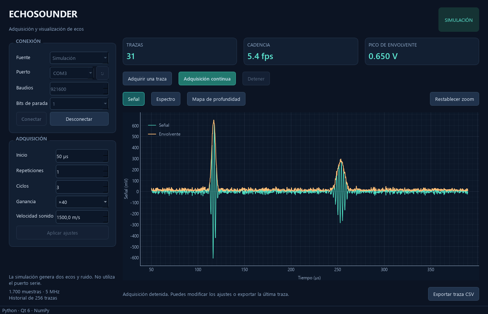
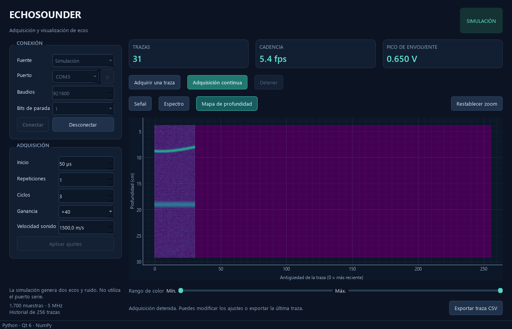

# Echosounder Python

Versión inicial de la aplicación de escritorio, escrita en Python y basada en el estudio del ejecutable original. Incluye una simulación autónoma y un cliente del protocolo serie reconstruido. No requiere el SDK de Qt 5 ni las DLL del programa C++.



## Arranque en esta carpeta

El entorno `.venv` ya está instalado en la máquina de desarrollo. Haz doble clic en **`Echosounder-Python.bat`**, en la raíz del proyecto. La ventana empieza desconectada y con Simulación seleccionada.

Para abrirla directamente adquiriendo datos simulados, desde PowerShell en la raíz:

```powershell
.\.venv\Scripts\python.exe -m echosounder --simulate
```

Para el uso normal, omite `--simulate` o utiliza el lanzador. El programa solo abre un puerto físico cuando seleccionas la fuente serie y pulsas Conectar.

## Instalación en otra máquina

Se necesita Python de 64 bits, versión 3.11 o posterior. La implementación se ha probado en Windows con Python 3.14. Los módulos de procesamiento y transporte son portables; la interfaz aún no se ha probado en Linux o macOS.

```powershell
python -m venv .venv
.\.venv\Scripts\python.exe -m pip install -e .
.\.venv\Scripts\python.exe -m echosounder
```

También se instala el comando `echosounder` en el entorno virtual. No es necesario activar el entorno ni cambiar la política de ejecución de PowerShell. Para ver un error de arranque que el lanzador gráfico no muestre, ejecuta el último comando en una consola.

## Funciones

- Adquisición de una traza o continua, parada y desconexión.
- Simulador con dos reflectores, un eco móvil, ruido y efectos de los ajustes de adquisición.
- Configuración de puerto, baudios, bits de parada, retardo, repeticiones, ciclos, ganancia y velocidad del sonido.
- Señal temporal y envolvente; espectro; mapa de profundidad de las últimas 256 trazas.
- Zoom y desplazamiento con el ratón, restablecimiento de ejes y ajuste de rango de color.
- Exportación CSV de la última traza, con muestras originales, tiempo, profundidad, señal, envolvente y metadatos.
- Comunicación y procesado fuera del hilo de la interfaz.

La simulación aparece identificada en la cabecera. Sus datos no proceden del instrumento. Los gráficos usan escalas temporales y de profundidad equivalentes a las del cliente original.

## Uso con el instrumento

1. Selecciona **Ecosonda por puerto serie**.
2. Elige el puerto; el botón junto al campo actualiza la lista. También puedes escribir el nombre del puerto.
3. Revisa los ajustes de conexión y adquisición. Los valores iniciales son 921.600 baudios, un bit de parada, 50 µs de retardo, una repetición, tres ciclos, ganancia ×40 y 1.500 m/s.
4. Pulsa **Conectar**. La aplicación comprueba el saludo, consulta versión y configura el instrumento.
5. Usa **Adquirir una traza** o **Adquisición continua**.
6. Pulsa **Detener** antes de modificar ajustes. Los cambios se envían con **Aplicar ajustes** y reinician el historial para no mezclar escalas. La adquisición se deshabilita mientras haya ajustes pendientes de confirmar.

Los ajustes de puerto requieren desconectar. Los datos anteriores se pueden exportar después de desconectar; el CSV conserva los ajustes de esa adquisición.

La implementación física **todavía no se ha validado con una ecosonda real ni con su firmware**. El contrato se ha deducido del binario y se prueba con un simulador de bytes independiente. Requiere 1.700 enteros de 32 bits little-endian por traza y presupone 5 MHz. Los bytes de relleno se envían a cero; falta confirmar esa convención con el firmware.

Si una transacción falla, la sesión se cierra y se muestra el error. No se reintenta automáticamente una adquisición parcial porque el protocolo identificado no ofrece una cabecera o un CRC con los que resincronizarla de forma fiable.

**Detener** deja terminar la traza en curso para mantener el alineamiento del flujo serie. La lectura tiene un plazo total de un segundo. Desconectar o cerrar la ventana solicita cancelación y cierra el puerto en el hilo de adquisición. La aplicación no envía una orden de parada al firmware: no se identificó tal orden en el cliente original.

## Decisiones numéricas respecto al original

| Aspecto | Versión Python |
| --- | --- |
| Tamaño y muestreo | 1.700 muestras, 5 MHz |
| Conversión ADC | Conserva la resta de la media y el divisor `2^(12 + ceil(log2(R))) - 1` |
| Envolvente | Usa la señal analítica estándar, con tratamiento explícito de DC y Nyquist y padding hasta 2.048 puntos; corrige el corte peculiar `N/2 - 1` del binario |
| Espectro | FFT real de las primeras 1.024 muestras, 512 puntos mostrados y normalización por `512²`; no mezcla DC y Nyquist |
| Suelo de representación | −240 dB para evitar valores infinitos cuando la potencia es cero |
| Etiqueta espectral | Nivel espectral en dBV; no se presenta como densidad calibrada por Hz |
| Profundidad | Trayecto de ida y vuelta, velocidad configurable y unidades en centímetros |
| Mapa | Raíz de la envolvente, 256 trazas, muestra nueva en la columna 0 |
| Ganancia | Se muestra como multiplicador; el código no compensa esa ganancia al convertir a voltios |

La escala de acumulación se conserva por compatibilidad con el cliente, pero requiere contrastar el comportamiento real del firmware, especialmente con repeticiones que no sean potencias de dos. Las magnitudes no representan una calibración acústica.



## Organización del código

```text
echosounder/
  __main__.py       Punto de entrada y opción --simulate
  model.py          Ajustes, constantes y estructura de cada traza
  device.py         Protocolo serie y generador de datos simulados
  processing.py     Conversión, envolvente y espectro con NumPy
  worker.py         Hilo propietario de la conexión y cola de órdenes
  gui.py            Ventana, controles y gráficos
  export.py         Exportación CSV
tests/              Pruebas de protocolo, procesamiento e interfaz
tools/
  capture_preview.py  Capturas de las tres vistas sin hardware
```

No se necesita recompilar C++ para modificar la aplicación Python. El paquete no depende de los `.o` ni de los recursos generados del programa original. El ejecutable C++ se conserva como referencia.

## Dependencias y pruebas

Dependencias declaradas en `pyproject.toml`: PySide6, PyQtGraph, NumPy y pySerial. pytest se utiliza únicamente para pruebas. Versiones comprobadas en el entorno de desarrollo: PySide6 6.12.0, PyQtGraph 0.14.0, NumPy 2.5.4, pySerial 3.5 y pytest 9.2.0.

```powershell
.\.venv\Scripts\python.exe -m pip install -e '.[test]'
.\.venv\Scripts\python.exe -m pytest -q
.\.venv\Scripts\python.exe -m pip check
```

La batería inicial contiene 21 pruebas: saludo y configuración, tramas fragmentadas, escrituras parciales, confirmaciones inválidas, cancelación, respuesta incompleta, tono conocido, envolvente, escalas y CSV, además del ciclo de conexión/adquisición/parada/cierre de la interfaz en simulación. No abre puertos físicos. Las capturas se generan aparte con:

```powershell
.\.venv\Scripts\python.exe tools\capture_preview.py
```

Documentación primaria utilizada: [señales y slots de Qt para Python](https://doc.qt.io/qtforpython-6/tutorials/basictutorial/signals_and_slots.html), [lectura y tiempos de espera de pySerial](https://pyserial.readthedocs.io/en/latest/pyserial_api.html), [ImageItem de PyQtGraph](https://pyqtgraph.readthedocs.io/en/latest/api_reference/graphicsItems/imageitem.html) y [FFT real de NumPy](https://numpy.org/doc/stable/reference/generated/numpy.fft.rfft.html).
